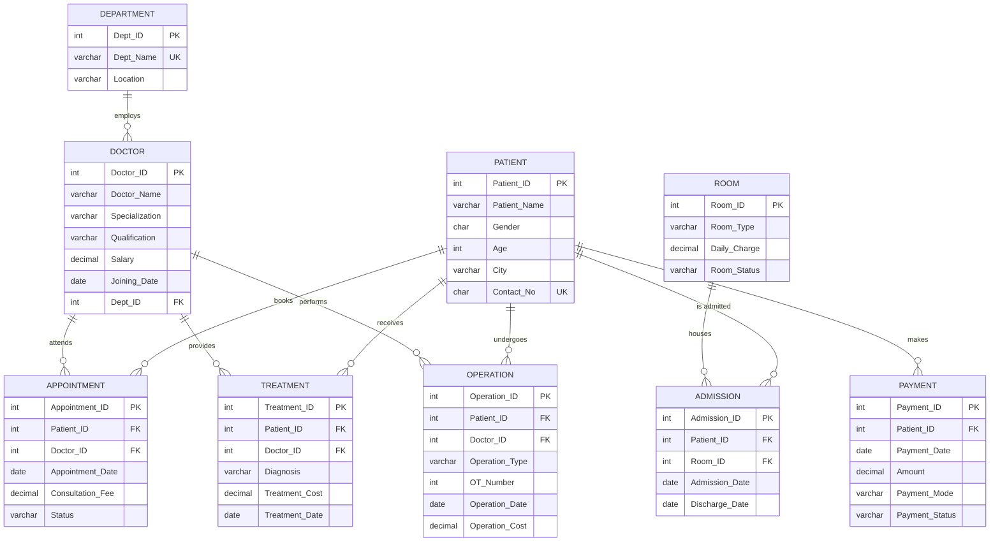

# Assignment 2 – Smart Hospital Management System

**Database design, implementation and SQL query solutions**

| Item                 | Detail                                                                                                                 |
| -------------------- | ---------------------------------------------------------------------------------------------------------------------- |
| SQL environment used | MySQL                                                                                                                  |
| Companion file       | `hospital_management.sql` (schema + data + all 30 queries, runs top to bottom)                                         |
| Tables               | 9 (4 master: DEPARTMENT, DOCTOR, PATIENT, ROOM · 5 transaction: APPOINTMENT, ADMISSION, TREATMENT, OPERATION, PAYMENT) |
## Part A – Database Schema Design

### A.1 Entity-Relationship (ER) Diagram



**Relationships and cardinalities**

| Relationship                             | Cardinality | Meaning                                                                                                           |
| ---------------------------------------- | ----------- | ----------------------------------------------------------------------------------------------------------------- |
| DEPARTMENT – DOCTOR                      | 1 : N       | A department employs many doctors; each doctor belongs to exactly one department (a department may have none yet) |
| PATIENT – APPOINTMENT                    | 1 : N       | A patient can book many appointments; each appointment is for one patient                                         |
| DOCTOR – APPOINTMENT                     | 1 : N       | A doctor can have many appointments (or none); each appointment is with one doctor                                |
| PATIENT – ADMISSION                      | 1 : N       | A patient can be admitted many times                                                                              |
| ROOM – ADMISSION                         | 1 : N       | A room is used by many admissions over time (one patient at a time)                                               |
| PATIENT – TREATMENT / DOCTOR – TREATMENT | 1 : N each  | TREATMENT resolves the M:N between patients and doctors                                                           |
| PATIENT – OPERATION / DOCTOR – OPERATION | 1 : N each  | OPERATION resolves another M:N between patients and doctors                                                       |
| PATIENT – PAYMENT                        | 1 : N       | A patient makes many payments                                                                                     |

### A.2 Relational schema

| Table | Primary key | Foreign keys | Other constraints |
|---|---|---|---|
| DEPARTMENT | Dept_ID | – | Dept_Name NOT NULL UNIQUE |
| DOCTOR | Doctor_ID | Dept_ID → DEPARTMENT | Salary > 0, all columns NOT NULL |
| PATIENT | Patient_ID | – | Gender IN (M,F,O); Age 0–120; Contact_No UNIQUE, 10 characters |
| APPOINTMENT | Appointment_ID | Patient_ID → PATIENT, Doctor_ID → DOCTOR | Fee ≥ 0; Status IN (Scheduled, Completed, Cancelled), default Scheduled |
| ROOM | Room_ID | – | Room_Type IN (General Ward, Semi-Private, Private, ICU, Deluxe); Daily_Charge > 0; Room_Status IN (Available, Occupied, Maintenance) |
| ADMISSION | Admission_ID | Patient_ID → PATIENT, Room_ID → ROOM | Discharge_Date NULL or ≥ Admission_Date (NULL = still admitted) |
| TREATMENT | Treatment_ID | Patient_ID → PATIENT, Doctor_ID → DOCTOR | Treatment_Cost ≥ 0 |
| OPERATION | Operation_ID | Patient_ID → PATIENT, Doctor_ID → DOCTOR | Operation_Type IN (Major, Minor); OT_Number 1–10; Cost ≥ 0 |
| PAYMENT | Payment_ID | Patient_ID → PATIENT | Amount > 0; Mode IN (Cash, Card, UPI, Net Banking, Insurance); Status IN (Completed, Pending, Failed) |

### A.3 CREATE TABLE statements

```sql
DROP VIEW  IF EXISTS Doctor_Department_Report;
DROP TABLE IF EXISTS PAYMENT;
DROP TABLE IF EXISTS OPERATION;
DROP TABLE IF EXISTS TREATMENT;
DROP TABLE IF EXISTS ADMISSION;
DROP TABLE IF EXISTS APPOINTMENT;
DROP TABLE IF EXISTS ROOM;
DROP TABLE IF EXISTS PATIENT;
DROP TABLE IF EXISTS DOCTOR;
DROP TABLE IF EXISTS DEPARTMENT;

CREATE TABLE DEPARTMENT (
    Dept_ID    INT          PRIMARY KEY,
    Dept_Name  VARCHAR(50)  NOT NULL UNIQUE,
    Location   VARCHAR(60)  NOT NULL
);

CREATE TABLE DOCTOR (
    Doctor_ID      INT           PRIMARY KEY,
    Doctor_Name    VARCHAR(60)   NOT NULL,
    Specialization VARCHAR(60)   NOT NULL,
    Qualification  VARCHAR(60)   NOT NULL,
    Salary         DECIMAL(10,2) NOT NULL CHECK (Salary > 0),
    Joining_Date   DATE          NOT NULL,
    Dept_ID        INT           NOT NULL,
    CONSTRAINT fk_doctor_dept FOREIGN KEY (Dept_ID) REFERENCES DEPARTMENT (Dept_ID)
);

CREATE TABLE PATIENT (
    Patient_ID   INT          PRIMARY KEY,
    Patient_Name VARCHAR(60)  NOT NULL,
    Gender       CHAR(1)      NOT NULL CHECK (Gender IN ('M','F','O')),
    Age          INT          NOT NULL CHECK (Age BETWEEN 0 AND 120),
    City         VARCHAR(40)  NOT NULL,
    Contact_No   CHAR(10)     NOT NULL UNIQUE CHECK (CHAR_LENGTH(Contact_No) = 10)
);

CREATE TABLE APPOINTMENT (
    Appointment_ID   INT           PRIMARY KEY,
    Patient_ID       INT           NOT NULL,
    Doctor_ID        INT           NOT NULL,
    Appointment_Date DATE          NOT NULL,
    Consultation_Fee DECIMAL(8,2)  NOT NULL CHECK (Consultation_Fee >= 0),
    Status           VARCHAR(10)   NOT NULL DEFAULT 'Scheduled'
                     CHECK (Status IN ('Scheduled','Completed','Cancelled')),
    CONSTRAINT fk_appt_patient FOREIGN KEY (Patient_ID) REFERENCES PATIENT (Patient_ID),
    CONSTRAINT fk_appt_doctor  FOREIGN KEY (Doctor_ID)  REFERENCES DOCTOR (Doctor_ID)
);

CREATE TABLE ROOM (
    Room_ID      INT           PRIMARY KEY,
    Room_Type    VARCHAR(20)   NOT NULL
                 CHECK (Room_Type IN ('General Ward','Semi-Private','Private','ICU','Deluxe')),
    Daily_Charge DECIMAL(8,2)  NOT NULL CHECK (Daily_Charge > 0),
    Room_Status  VARCHAR(15)   NOT NULL DEFAULT 'Available'
                 CHECK (Room_Status IN ('Available','Occupied','Maintenance'))
);

CREATE TABLE ADMISSION (
    Admission_ID   INT   PRIMARY KEY,
    Patient_ID     INT   NOT NULL,
    Room_ID        INT   NOT NULL,
    Admission_Date DATE  NOT NULL,
    Discharge_Date DATE  NULL,                       -- NULL = still admitted
    CONSTRAINT fk_adm_patient FOREIGN KEY (Patient_ID) REFERENCES PATIENT (Patient_ID),
    CONSTRAINT fk_adm_room    FOREIGN KEY (Room_ID)    REFERENCES ROOM (Room_ID),
    CONSTRAINT chk_adm_dates  CHECK (Discharge_Date IS NULL OR Discharge_Date >= Admission_Date)
);

CREATE TABLE TREATMENT (
    Treatment_ID   INT            PRIMARY KEY,
    Patient_ID     INT            NOT NULL,
    Doctor_ID      INT            NOT NULL,
    Diagnosis      VARCHAR(100)   NOT NULL,
    Treatment_Cost DECIMAL(10,2)  NOT NULL CHECK (Treatment_Cost >= 0),
    Treatment_Date DATE           NOT NULL,
    CONSTRAINT fk_treat_patient FOREIGN KEY (Patient_ID) REFERENCES PATIENT (Patient_ID),
    CONSTRAINT fk_treat_doctor  FOREIGN KEY (Doctor_ID)  REFERENCES DOCTOR (Doctor_ID)
);

CREATE TABLE OPERATION (
    Operation_ID   INT            PRIMARY KEY,
    Patient_ID     INT            NOT NULL,
    Doctor_ID      INT            NOT NULL,
    Operation_Type VARCHAR(10)    NOT NULL CHECK (Operation_Type IN ('Major','Minor')),
    OT_Number      INT            NOT NULL CHECK (OT_Number BETWEEN 1 AND 10),
    Operation_Date DATE           NOT NULL,
    Operation_Cost DECIMAL(10,2)  NOT NULL CHECK (Operation_Cost >= 0),
    CONSTRAINT fk_op_patient FOREIGN KEY (Patient_ID) REFERENCES PATIENT (Patient_ID),
    CONSTRAINT fk_op_doctor  FOREIGN KEY (Doctor_ID)  REFERENCES DOCTOR (Doctor_ID)
);

CREATE TABLE PAYMENT (
    Payment_ID     INT            PRIMARY KEY,
    Patient_ID     INT            NOT NULL,
    Payment_Date   DATE           NOT NULL,
    Amount         DECIMAL(10,2)  NOT NULL CHECK (Amount > 0),
    Payment_Mode   VARCHAR(15)    NOT NULL
                   CHECK (Payment_Mode IN ('Cash','Card','UPI','Net Banking','Insurance')),
    Payment_Status VARCHAR(10)    NOT NULL
                   CHECK (Payment_Status IN ('Completed','Pending','Failed')),
    CONSTRAINT fk_pay_patient FOREIGN KEY (Patient_ID) REFERENCES PATIENT (Patient_ID)
);
```

### A.4 Sample data
| Table       | Row Count |
| :---------- | --------: |
| DEPARTMENT  |        10 |
| DOCTOR      |        13 |
| PATIENT     |        16 |
| ROOM        |        10 |
| APPOINTMENT |        22 |
| ADMISSION   |        22 |
| TREATMENT   |        22 |
| OPERATION   |        20 |
| PAYMENT     |        24 |

- Data variety built in: 
patients with several treatments (1, 2, 3, 5, 6, 9, 10, 12, 13, 16); 
doctors with no appointments (106, 112); 
17 discharged and 5 currently admitted patients; 
Completed, Pending and Failed payments; 
four patients with no payments; 
departments with no doctors (Gynecology, Radiology, ENT) and with no treatments (Dermatology).

The INSERT statements are in the `.sql` file. Table contents as loaded (before Q1–Q5 change anything):


**DEPARTMENT**

| Dept_ID | Dept_Name       | Location              |
| ------- | --------------- | --------------------- |
| 1       | Cardiology      | Block A, Floor 2      |
| 2       | Neurology       | Block A, Floor 3      |
| 3       | Orthopedics     | Block B, Floor 1      |
| 4       | Pediatrics      | Block C, Floor 1      |
| 5       | Oncology        | Block D, Floor 2      |
| 6       | Dermatology     | Block C, Floor 2      |
| 7       | General Surgery | Block B, Floor 2      |
| 8       | Gynecology      | Block C, Floor 3      |
| 9       | Radiology       | Block E, Ground Floor |
| 10      | ENT             | Block E, Floor 1      |

**DOCTOR**

| Doctor_ID | Doctor_Name       | Specialization            | Qualification     | Salary    | Joining_Date | Dept_ID |
| --------- | ----------------- | ------------------------- | ----------------- | --------- | ------------ | ------- |
| 101       | Dr. Anil Sharma   | Interventional Cardiology | MD, DM Cardiology | 120000.00 | 2015-06-01   | 1       |
| 102       | Dr. Meera Kapoor  | Cardiologist              | MD Medicine       | 95000.00  | 2018-03-15   | 1       |
| 103       | Dr. Rohit Verma   | Cardiac Electrophysiology | MD, DM Cardiology | 88000.00  | 2019-08-20   | 1       |
| 104       | Dr. Sunita Rao    | Cardiologist              | MD Medicine       | 80000.00  | 2020-01-10   | 1       |
| 105       | Dr. Vikram Singh  | Neurologist               | MD, DM Neurology  | 110000.00 | 2014-11-05   | 2       |
| 106       | Dr. Pooja Mishra  | Neurologist               | MD Medicine       | 72000.00  | 2021-07-01   | 2       |
| 107       | Dr. Arjun Yadav   | Orthopedic Surgeon        | MS Orthopedics    | 98000.00  | 2016-04-18   | 3       |
| 108       | Dr. Kavita Joshi  | Orthopedic Surgeon        | MS Orthopedics    | 58000.00  | 2023-02-01   | 3       |
| 109       | Dr. Imran Khan    | Pediatrician              | MD Pediatrics     | 55000.00  | 2023-09-12   | 4       |
| 110       | Dr. Neha Gupta    | Pediatrician              | MD Pediatrics     | 62000.00  | 2022-05-30   | 4       |
| 111       | Dr. Sanjay Tiwari | General Surgeon           | MS Surgery        | 105000.00 | 2013-09-09   | 7       |
| 112       | Dr. Ritu Saxena   | Dermatologist             | MD Dermatology    | 59000.00  | 2024-01-15   | 6       |
| 113       | Dr. Farhan Ali    | Oncologist                | MD, DM Oncology   | 92000.00  | 2017-12-01   | 5       |

**PATIENT**

| Patient_ID | Patient_Name     | Gender | Age | City      | Contact_No |
| ---------- | ---------------- | ------ | --- | --------- | ---------- |
| 1          | Rajesh Kumar     | M      | 65  | Kanpur    | 9810000001 |
| 2          | Sunita Devi      | F      | 72  | Lucknow   | 9810000002 |
| 3          | Amit Pandey      | M      | 45  | Kanpur    | 9810000003 |
| 4          | Priya Singh      | F      | 28  | Lucknow   | 9810000004 |
| 5          | Mohd. Arif       | M      | 68  | Ayodhya   | 9810000005 |
| 6          | Kavya Mishra     | F      | 8   | Kanpur    | 9810000006 |
| 7          | Ramesh Chandra   | M      | 61  | Kanpur    | 9810000007 |
| 8          | Anjali Verma     | F      | 34  | Varanasi  | 9810000008 |
| 9          | Suresh Yadav     | M      | 59  | Ayodhya   | 9810000009 |
| 10         | Geeta Srivastava | F      | 66  | Lucknow   | 9810000010 |
| 11         | Deepak Tripathi  | M      | 52  | Prayagraj | 9810000011 |
| 12         | Farah Naaz       | F      | 41  | Kanpur    | 9810000012 |
| 13         | Harish Gupta     | M      | 75  | Agra      | 9810000013 |
| 14         | Nisha Agarwal    | F      | 23  | Lucknow   | 9810000014 |
| 15         | Vivek Dubey      | M      | 38  | Kanpur    | 9810000015 |
| 16         | Shweta Rani      | F      | 31  | Kanpur    | 9810000016 |
**ROOM**

| Room_ID | Room_Type    | Daily_Charge | Room_Status |
| ------- | ------------ | ------------ | ----------- |
| 101     | General Ward | 1500.00      | Available   |
| 102     | General Ward | 1500.00      | Occupied    |
| 103     | Semi-Private | 3000.00      | Occupied    |
| 104     | Semi-Private | 3000.00      | Available   |
| 105     | Private      | 5000.00      | Occupied    |
| 106     | Private      | 5000.00      | Available   |
| 107     | ICU          | 12000.00     | Occupied    |
| 108     | ICU          | 12000.00     | Available   |
| 109     | Deluxe       | 8000.00      | Occupied    |
| 110     | General Ward | 1500.00      | Maintenance |


**APPOINTMENT**

| Appointment_ID | Patient_ID | Doctor_ID | Appointment_Date | Consultation_Fee | Status    |
| -------------- | ---------- | --------- | ---------------- | ---------------- | --------- |
| 1001           | 1          | 101       | 2026-09-02       | 1000.00          | Completed |
| 1002           | 2          | 105       | 2026-09-03       | 1200.00          | Completed |
| 1003           | 3          | 107       | 2026-09-05       | 800.00           | Completed |
| 1004           | 4          | 110       | 2026-09-07       | 600.00           | Cancelled |
| 1005           | 5          | 101       | 2026-09-10       | 1000.00          | Completed |
| 1006           | 6          | 109       | 2026-09-12       | 500.00           | Completed |
| 1007           | 7          | 102       | 2026-09-15       | 900.00           | Cancelled |
| 1008           | 8          | 111       | 2026-09-18       | 1100.00          | Completed |
| 1009           | 9          | 103       | 2026-09-21       | 900.00           | Completed |
| 1010           | 10         | 104       | 2026-09-25       | 900.00           | Completed |
| 1011           | 1          | 101       | 2026-10-02       | 1000.00          | Completed |
| 1012           | 11         | 105       | 2026-10-06       | 1200.00          | Cancelled |
| 1013           | 12         | 108       | 2026-10-09       | 800.00           | Completed |
| 1014           | 13         | 113       | 2026-10-14       | 1500.00          | Completed |
| 1015           | 2          | 102       | 2026-10-18       | 900.00           | Completed |
| 1016           | 3          | 111       | 2026-10-22       | 1100.00          | Cancelled |
| 1017           | 14         | 110       | 2026-11-02       | 600.00           | Completed |
| 1018           | 5          | 103       | 2026-11-05       | 900.00           | Completed |
| 1019           | 7          | 104       | 2026-11-10       | 900.00           | Scheduled |
| 1020           | 15         | 107       | 2026-11-14       | 800.00           | Scheduled |
| 1021           | 10         | 113       | 2026-11-25       | 1500.00          | Scheduled |
| 1022           | 8          | 109       | 2026-11-28       | 500.00           | Scheduled |

**ADMISSION**

| Admission_ID | Patient_ID | Room_ID | Admission_Date | Discharge_Date |
| ------------ | ---------- | ------- | -------------- | -------------- |
| 5001         | 1          | 101     | 2026-09-02     | 2026-09-08     |
| 5002         | 3          | 104     | 2026-09-05     | 2026-09-12     |
| 5003         | 5          | 105     | 2026-09-10     | 2026-09-20     |
| 5004         | 6          | 102     | 2026-09-12     | 2026-09-16     |
| 5005         | 8          | 106     | 2026-09-18     | 2026-09-24     |
| 5006         | 7          | 108     | 2026-09-28     | 2026-10-05     |
| 5007         | 9          | 101     | 2026-09-21     | 2026-09-25     |
| 5008         | 10         | 104     | 2026-09-25     | 2026-09-30     |
| 5009         | 12         | 102     | 2026-10-09     | 2026-10-15     |
| 5010         | 13         | 108     | 2026-10-14     | 2026-10-26     |
| 5011         | 2          | 106     | 2026-10-18     | 2026-10-23     |
| 5012         | 1          | 101     | 2026-10-02     | 2026-10-08     |
| 5013         | 3          | 104     | 2026-10-23     | 2026-10-28     |
| 5014         | 16         | 107     | 2026-10-30     | 2026-11-07     |
| 5015         | 6          | 102     | 2026-11-15     | 2026-11-17     |
| 5016         | 9          | 101     | 2026-11-08     | 2026-11-11     |
| 5017         | 12         | 106     | 2026-11-12     | 2026-11-16     |
| 5018         | 5          | 103     | 2026-11-05     | NULL           |
| 5019         | 2          | 107     | 2026-11-15     | NULL           |
| 5020         | 10         | 105     | 2026-11-15     | NULL           |
| 5021         | 13         | 109     | 2026-11-18     | NULL           |
| 5022         | 1          | 102     | 2026-11-19     | NULL           |

**TREATMENT**

| Treatment_ID | Patient_ID | Doctor_ID | Diagnosis                   | Treatment_Cost | Treatment_Date |
| ------------ | ---------- | --------- | --------------------------- | -------------- | -------------- |
| 2001         | 1          | 101       | Coronary Artery Disease     | 45000.00       | 2026-09-02     |
| 2002         | 1          | 101       | Hypertension                | 8000.00        | 2026-10-02     |
| 2003         | 2          | 105       | Migraine with Aura          | 15000.00       | 2026-09-03     |
| 2004         | 2          | 102       | Arrhythmia                  | 22000.00       | 2026-10-18     |
| 2005         | 3          | 107       | Knee Osteoarthritis         | 30000.00       | 2026-09-05     |
| 2006         | 5          | 101       | Heart Failure               | 60000.00       | 2026-09-10     |
| 2007         | 5          | 103       | Atrial Fibrillation         | 35000.00       | 2026-11-05     |
| 2008         | 6          | 109       | Pneumonia                   | 12000.00       | 2026-09-12     |
| 2009         | 7          | 104       | Angina                      | 18000.00       | 2026-09-28     |
| 2010         | 8          | 111       | Appendicitis                | 40000.00       | 2026-09-18     |
| 2011         | 9          | 103       | Cardiac Arrhythmia          | 20000.00       | 2026-09-21     |
| 2012         | 10         | 104       | Chest Pain                  | 9000.00        | 2026-09-25     |
| 2013         | 10         | 113       | Breast Lump Evaluation      | 28000.00       | 2026-10-15     |
| 2014         | 12         | 108       | Femur Fracture              | 38000.00       | 2026-10-09     |
| 2015         | 13         | 113       | Lymphoma                    | 85000.00       | 2026-10-14     |
| 2016         | 13         | 105       | Ischemic Stroke             | 70000.00       | 2026-10-16     |
| 2017         | 3          | 111       | Inguinal Hernia             | 32000.00       | 2026-10-23     |
| 2018         | 16         | 107       | Road Accident Fracture      | 55000.00       | 2026-10-30     |
| 2019         | 16         | 111       | Emergency Laparotomy        | 48000.00       | 2026-11-01     |
| 2020         | 9          | 103       | Cardiac Follow-up           | 6000.00        | 2026-11-08     |
| 2021         | 12         | 108       | Post-fracture Physiotherapy | 7000.00        | 2026-11-12     |
| 2022         | 6          | 110       | Childhood Asthma            | 9000.00        | 2026-11-15     |
**OPERATION**

| Operation_ID | Patient_ID | Doctor_ID | Operation_Type | OT_Number | Operation_Date | Operation_Cost |
| ------------ | ---------- | --------- | -------------- | --------- | -------------- | -------------- |
| 3001         | 1          | 101       | Major          | 1         | 2026-09-03     | 150000.00      |
| 3002         | 3          | 107       | Major          | 2         | 2026-09-06     | 120000.00      |
| 3003         | 5          | 101       | Major          | 1         | 2026-09-11     | 180000.00      |
| 3004         | 8          | 111       | Major          | 3         | 2026-09-18     | 90000.00       |
| 3005         | 12         | 108       | Minor          | 2         | 2026-10-10     | 30000.00       |
| 3006         | 13         | 113       | Major          | 4         | 2026-10-15     | 200000.00      |
| 3007         | 13         | 105       | Major          | 5         | 2026-10-17     | 160000.00      |
| 3008         | 3          | 111       | Minor          | 3         | 2026-10-23     | 45000.00       |
| 3009         | 16         | 107       | Major          | 2         | 2026-10-31     | 140000.00      |
| 3010         | 16         | 111       | Major          | 3         | 2026-11-01     | 110000.00      |
| 3011         | 2          | 102       | Minor          | 1         | 2026-10-19     | 25000.00       |
| 3012         | 9          | 103       | Minor          | 1         | 2026-09-22     | 20000.00       |
| 3013         | 10         | 113       | Minor          | 4         | 2026-10-16     | 35000.00       |
| 3014         | 7          | 104       | Major          | 1         | 2026-09-29     | 130000.00      |
| 3015         | 6          | 109       | Minor          | 5         | 2026-09-13     | 12000.00       |
| 3016         | 12         | 107       | Minor          | 2         | 2026-10-11     | 18000.00       |
| 3017         | 5          | 102       | Minor          | 1         | 2026-11-06     | 22000.00       |
| 3018         | 1          | 101       | Major          | 1         | 2026-10-03     | 170000.00      |
| 3019         | 9          | 111       | Minor          | 3         | 2026-11-09     | 15000.00       |
| 3020         | 10         | 104       | Minor          | 5         | 2026-11-12     | 16000.00       |

**PAYMENT**

| Payment_ID | Patient_ID | Payment_Date | Amount    | Payment_Mode | Payment_Status |
| ---------- | ---------- | ------------ | --------- | ------------ | -------------- |
| 4001       | 1          | 2026-09-05   | 50000.00  | UPI          | Completed      |
| 4002       | 1          | 2026-10-06   | 150000.00 | Insurance    | Completed      |
| 4003       | 1          | 2026-10-20   | 20000.00  | Card         | Pending        |
| 4004       | 2          | 2026-09-10   | 20000.00  | Cash         | Completed      |
| 4005       | 2          | 2026-10-25   | 30000.00  | Card         | Completed      |
| 4006       | 3          | 2026-09-08   | 30000.00  | Cash         | Completed      |
| 4007       | 3          | 2026-10-28   | 50000.00  | Net Banking  | Completed      |
| 4008       | 5          | 2026-09-15   | 100000.00 | Insurance    | Completed      |
| 4009       | 5          | 2026-11-08   | 80000.00  | UPI          | Completed      |
| 4010       | 5          | 2026-11-12   | 40000.00  | Card         | Failed         |
| 4011       | 6          | 2026-09-16   | 12000.00  | Cash         | Completed      |
| 4012       | 6          | 2026-11-16   | 5000.00   | UPI          | Pending        |
| 4013       | 7          | 2026-10-01   | 60000.00  | Insurance    | Completed      |
| 4014       | 8          | 2026-09-20   | 45000.00  | Card         | Completed      |
| 4015       | 9          | 2026-09-30   | 25000.00  | UPI          | Completed      |
| 4016       | 9          | 2026-11-10   | 12000.00  | Cash         | Pending        |
| 4017       | 10         | 2026-10-20   | 50000.00  | Net Banking  | Completed      |
| 4018       | 10         | 2026-11-15   | 20000.00  | Card         | Pending        |
| 4019       | 12         | 2026-10-15   | 45000.00  | Cash         | Completed      |
| 4020       | 13         | 2026-10-25   | 200000.00 | Insurance    | Completed      |
| 4021       | 13         | 2026-11-02   | 100000.00 | Card         | Failed         |
| 4022       | 16         | 2026-11-03   | 100000.00 | UPI          | Completed      |
| 4023       | 16         | 2026-11-10   | 60000.00  | Net Banking  | Completed      |
| 4024       | 12         | 2026-11-14   | 7000.00   | Cash         | Pending        |

---

## Part B – SQL Queries, Outputs and Explanations

### Section 1: Basic SQL and Data Manipulation

#### Q1. Add a new cardiologist

**SQL**

```sql
INSERT INTO DOCTOR (Doctor_ID, Doctor_Name, Specialization, Qualification, Salary, Joining_Date, Dept_ID)
VALUES (114, 'Dr. Aditi Bansal', 'Cardiologist', 'MD, DM Cardiology', 85000, '2026-11-01',
        (SELECT Dept_ID FROM DEPARTMENT WHERE Dept_Name = 'Cardiology'));

SELECT d.Doctor_ID, d.Doctor_Name, d.Specialization, d.Salary, d.Dept_ID, dep.Dept_Name
FROM   DOCTOR d
JOIN   DEPARTMENT dep ON dep.Dept_ID = d.Dept_ID
WHERE  d.Doctor_ID = 114;
```

**Output**

```text
+-----------+------------------+----------------+----------+---------+------------+
| Doctor_ID | Doctor_Name      | Specialization | Salary   | Dept_ID | Dept_Name  |
+-----------+------------------+----------------+----------+---------+------------+
|       114 | Dr. Aditi Bansal | Cardiologist   | 85000.00 |       1 | Cardiology |
+-----------+------------------+----------------+----------+---------+------------+
```

**Explanation:** The department ID is looked up by name with a sub-select, so the doctor is attached to Cardiology without hard-coding the ID. The verification query joins DOCTOR to DEPARTMENT to prove the row exists and points to the right department.


#### Q2. Raise salaries below ₹60,000 by 15%

**SQL**

```sql
-- Before
SELECT Doctor_ID, Doctor_Name, Salary FROM DOCTOR ORDER BY Doctor_ID;

UPDATE DOCTOR
SET    Salary = Salary * 1.15
WHERE  Salary < 60000;

-- After (only doctors 108, 109 and 112 should differ)
SELECT Doctor_ID, Doctor_Name, Salary FROM DOCTOR ORDER BY Doctor_ID;
```

**Output**

```text
+-----------+-------------------+-----------+
| Doctor_ID | Doctor_Name       | Salary    |
+-----------+-------------------+-----------+
|       101 | Dr. Anil Sharma   | 120000.00 |
|       102 | Dr. Meera Kapoor  |  95000.00 |
|       103 | Dr. Rohit Verma   |  88000.00 |
|       104 | Dr. Sunita Rao    |  80000.00 |
|       105 | Dr. Vikram Singh  | 110000.00 |
|       106 | Dr. Pooja Mishra  |  72000.00 |
|       107 | Dr. Arjun Yadav   |  98000.00 |
|       108 | Dr. Kavita Joshi  |  58000.00 |
|       109 | Dr. Imran Khan    |  55000.00 |
|       110 | Dr. Neha Gupta    |  62000.00 |
|       111 | Dr. Sanjay Tiwari | 105000.00 |
|       112 | Dr. Ritu Saxena   |  59000.00 |
|       113 | Dr. Farhan Ali    |  92000.00 |
|       114 | Dr. Aditi Bansal  |  85000.00 |
+-----------+-------------------+-----------+
+-----------+-------------------+-----------+
| Doctor_ID | Doctor_Name       | Salary    |
+-----------+-------------------+-----------+
|       101 | Dr. Anil Sharma   | 120000.00 |
|       102 | Dr. Meera Kapoor  |  95000.00 |
|       103 | Dr. Rohit Verma   |  88000.00 |
|       104 | Dr. Sunita Rao    |  80000.00 |
|       105 | Dr. Vikram Singh  | 110000.00 |
|       106 | Dr. Pooja Mishra  |  72000.00 |
|       107 | Dr. Arjun Yadav   |  98000.00 |
|       108 | Dr. Kavita Joshi  |  66700.00 |
|       109 | Dr. Imran Khan    |  63250.00 |
|       110 | Dr. Neha Gupta    |  62000.00 |
|       111 | Dr. Sanjay Tiwari | 105000.00 |
|       112 | Dr. Ritu Saxena   |  67850.00 |
|       113 | Dr. Farhan Ali    |  92000.00 |
|       114 | Dr. Aditi Bansal  |  85000.00 |
+-----------+-------------------+-----------+
```

**Explanation:** The WHERE clause restricts the UPDATE to rows with Salary < 60000, so only doctors 108 (58,000 → 66,700), 109 (55,000 → 63,250) and 112 (59,000 → 67,850) change. The before/after listings prove every other salary is untouched.


#### Q3. Patients over 60 from Kanpur, Lucknow or Ayodhya

**SQL**

```sql
SELECT Patient_ID, Patient_Name, Age, City
FROM   PATIENT
WHERE  Age > 60
  AND  City IN ('Kanpur', 'Lucknow', 'Ayodhya')
ORDER  BY Age DESC;
```

**Output**

```text
+------------+------------------+-----+---------+
| Patient_ID | Patient_Name     | Age | City    |
+------------+------------------+-----+---------+
|          2 | Sunita Devi      |  72 | Lucknow |
|          5 | Mohd. Arif       |  68 | Ayodhya |
|         10 | Geeta Srivastava |  66 | Lucknow |
|          1 | Rajesh Kumar     |  65 | Kanpur  |
|          7 | Ramesh Chandra   |  61 | Kanpur  |
+------------+------------------+-----+---------+
```

**Explanation:** AND combines the age filter with the IN list of cities. Harish Gupta (75, Agra) and Suresh Yadav (59, Ayodhya) are correctly excluded.


#### Q4. Correct a wrong consultation fee

**SQL**

```sql
SET @appt_id = 1008;
SET @new_fee = 1150;

SELECT * FROM APPOINTMENT WHERE Appointment_ID = @appt_id;   -- before

UPDATE APPOINTMENT
SET    Consultation_Fee = @new_fee
WHERE  Appointment_ID = @appt_id;

SELECT * FROM APPOINTMENT WHERE Appointment_ID = @appt_id;   -- after
```

**Output**

```text
+----------------+------------+-----------+------------------+------------------+-----------+
| Appointment_ID | Patient_ID | Doctor_ID | Appointment_Date | Consultation_Fee | Status    |
+----------------+------------+-----------+------------------+------------------+-----------+
|           1008 |          8 |       111 | 2026-09-18       |          1100.00 | Completed |
+----------------+------------+-----------+------------------+------------------+-----------+
+----------------+------------+-----------+------------------+------------------+-----------+
| Appointment_ID | Patient_ID | Doctor_ID | Appointment_Date | Consultation_Fee | Status    |
+----------------+------------+-----------+------------------+------------------+-----------+
|           1008 |          8 |       111 | 2026-09-18       |          1150.00 | Completed |
+----------------+------------+-----------+------------------+------------------+-----------+
```

**Explanation:** The primary key in the WHERE clause guarantees exactly one row is updated. Variables hold the appointment ID and new fee (in Oracle use &appt_id / &new_fee substitution variables). The second SELECT displays the corrected record.


#### Q5. View and delete old cancelled appointments

**SQL**

```sql
SET @cutoff = '2026-10-01';

SELECT * FROM APPOINTMENT WHERE Status = 'Cancelled' ORDER BY Appointment_Date;

SELECT Appointment_ID, Appointment_Date, Status FROM APPOINTMENT
WHERE  Status = 'Cancelled' AND Appointment_Date < @cutoff;

DELETE FROM APPOINTMENT
WHERE  Status = 'Cancelled'
  AND  Appointment_Date < @cutoff;
SELECT Status, COUNT(*) AS Total FROM APPOINTMENT GROUP BY Status ORDER BY Status;
```

**Output**

```text
+----------------+------------+-----------+------------------+------------------+-----------+
| Appointment_ID | Patient_ID | Doctor_ID | Appointment_Date | Consultation_Fee | Status    |
+----------------+------------+-----------+------------------+------------------+-----------+
|           1004 |          4 |       110 | 2026-09-07       |           600.00 | Cancelled |
|           1007 |          7 |       102 | 2026-09-15       |           900.00 | Cancelled |
|           1012 |         11 |       105 | 2026-10-06       |          1200.00 | Cancelled |
|           1016 |          3 |       111 | 2026-10-22       |          1100.00 | Cancelled |
+----------------+------------+-----------+------------------+------------------+-----------+
+----------------+------------------+-----------+
| Appointment_ID | Appointment_Date | Status    |
+----------------+------------------+-----------+
|           1004 | 2026-09-07       | Cancelled |
|           1007 | 2026-09-15       | Cancelled |
+----------------+------------------+-----------+
+-----------+-------+
| Status    | Total |
+-----------+-------+
| Cancelled |     2 |
| Completed |    14 |
| Scheduled |     4 |
+-----------+-------+
```

**Explanation:** The delete uses two conditions (Status = 'Cancelled' AND date < cutoff), so Completed and Scheduled rows can never match. Appointments 1004 and 1007 are removed; 1012 and 1016 stay because they are cancelled but on/after the cutoff. Status counts confirm Completed (14) and Scheduled (4) are unchanged.


### Section 2: Operators and Aggregate Functions

#### Q6. Doctor count per department (including empty departments)

**SQL**

```sql
SELECT dep.Dept_Name, COUNT(d.Doctor_ID) AS Doctor_Count
FROM   DEPARTMENT dep
LEFT JOIN DOCTOR d ON d.Dept_ID = dep.Dept_ID
GROUP  BY dep.Dept_ID, dep.Dept_Name
ORDER  BY Doctor_Count DESC, dep.Dept_Name;
```

**Output**

```text
+-----------------+--------------+
| Dept_Name       | Doctor_Count |
+-----------------+--------------+
| Cardiology      |            5 |
| Neurology       |            2 |
| Orthopedics     |            2 |
| Pediatrics      |            2 |
| Dermatology     |            1 |
| General Surgery |            1 |
| Oncology        |            1 |
| ENT             |            0 |
| Gynecology      |            0 |
| Radiology       |            0 |
+-----------------+--------------+
```

**Explanation:** A LEFT JOIN keeps every department even when no doctor matches. COUNT(d.Doctor_ID) counts only non-NULL doctor IDs, so Gynecology, Radiology and ENT correctly show 0 (COUNT(*) would wrongly show 1).


#### Q7. Min, max and average salary per department

**SQL**

```sql
SELECT dep.Dept_Name,
       MIN(d.Salary) AS Min_Salary,
       MAX(d.Salary) AS Max_Salary,
       ROUND(AVG(d.Salary), 2) AS Avg_Salary
FROM   DEPARTMENT dep
JOIN   DOCTOR d ON d.Dept_ID = dep.Dept_ID
GROUP  BY dep.Dept_ID, dep.Dept_Name
ORDER  BY AVG(d.Salary) DESC;
```

**Output**

```text
+-----------------+------------+------------+------------+
| Dept_Name       | Min_Salary | Max_Salary | Avg_Salary |
+-----------------+------------+------------+------------+
| General Surgery |  105000.00 |  105000.00 |  105000.00 |
| Cardiology      |   80000.00 |  120000.00 |   93600.00 |
| Oncology        |   92000.00 |   92000.00 |   92000.00 |
| Neurology       |   72000.00 |  110000.00 |   91000.00 |
| Orthopedics     |   66700.00 |   98000.00 |   82350.00 |
| Dermatology     |   67850.00 |   67850.00 |   67850.00 |
| Pediatrics      |   62000.00 |   63250.00 |   62625.00 |
+-----------------+------------+------------+------------+
```

**Explanation:** GROUP BY department with MIN, MAX and AVG. An inner join is used because a department with no doctors has no salaries to summarise. Ordering by AVG(Salary) DESC ranks departments by pay.


#### Q8. Departments with more than 3 doctors and average salary above ₹75,000

**SQL**

```sql
SELECT dep.Dept_Name,
       COUNT(d.Doctor_ID)      AS Doctor_Count,
       ROUND(AVG(d.Salary), 2) AS Avg_Salary
FROM   DEPARTMENT dep
JOIN   DOCTOR d ON d.Dept_ID = dep.Dept_ID
GROUP  BY dep.Dept_ID, dep.Dept_Name
HAVING COUNT(d.Doctor_ID) > 3
   AND AVG(d.Salary) > 75000;
```

**Output**

```text
+------------+--------------+------------+
| Dept_Name  | Doctor_Count | Avg_Salary |
+------------+--------------+------------+
| Cardiology |            5 |   93600.00 |
+------------+--------------+------------+
```

**Explanation:** Conditions on aggregates must go in HAVING (WHERE runs before grouping). Only Cardiology has more than three doctors (five, including the new hire) and an average well above ₹75,000.


#### Q9. Five most expensive treatments

**SQL**

```sql
SELECT Treatment_ID, Patient_ID, Diagnosis, Treatment_Cost
FROM   TREATMENT
ORDER  BY Treatment_Cost DESC, Treatment_ID
LIMIT  5;
-- Oracle 12c+ / standard SQL alternative: replace LIMIT 5 with  FETCH FIRST 5 ROWS ONLY
```

**Output**

```text
+--------------+------------+------------------------+----------------+
| Treatment_ID | Patient_ID | Diagnosis              | Treatment_Cost |
+--------------+------------+------------------------+----------------+
|         2015 |         13 | Lymphoma               |       85000.00 |
|         2016 |         13 | Ischemic Stroke        |       70000.00 |
|         2006 |          5 | Heart Failure          |       60000.00 |
|         2018 |         16 | Road Accident Fracture |       55000.00 |
|         2019 |         16 | Emergency Laparotomy   |       48000.00 |
+--------------+------------+------------------------+----------------+
```

**Explanation:** Sorting by cost descending with Treatment_ID as the tie-breaker, then keeping the first five rows, gives the top five. LIMIT is MySQL/MariaDB syntax; the standard form is FETCH FIRST 5 ROWS ONLY.


#### Q10. Collections per payment mode (completed payments only)

**SQL**

```sql
SELECT Payment_Mode,
       COUNT(*)    AS Completed_Payments,
       SUM(Amount) AS Total_Collection
FROM   PAYMENT
WHERE  Payment_Status = 'Completed'
GROUP  BY Payment_Mode
ORDER  BY Total_Collection DESC;
```

**Output**

```text
+--------------+--------------------+------------------+
| Payment_Mode | Completed_Payments | Total_Collection |
+--------------+--------------------+------------------+
| Insurance    |                  4 |        510000.00 |
| UPI          |                  4 |        255000.00 |
| Net Banking  |                  3 |        160000.00 |
| Cash         |                  4 |        107000.00 |
| Card         |                  2 |         75000.00 |
+--------------+--------------------+------------------+
```

**Explanation:** The WHERE clause filters out Pending and Failed payments before grouping, so only money actually received is counted for each mode.


### Section 3: Joins and Multi-Table Queries


#### Q11. Appointment report with patient, doctor and department

**SQL**

```sql
SELECT a.Appointment_ID, p.Patient_Name, d.Doctor_Name, dep.Dept_Name,
       a.Appointment_Date, a.Consultation_Fee
FROM   APPOINTMENT a
JOIN   PATIENT    p   ON p.Patient_ID = a.Patient_ID
JOIN   DOCTOR     d   ON d.Doctor_ID  = a.Doctor_ID
JOIN   DEPARTMENT dep ON dep.Dept_ID  = d.Dept_ID
ORDER  BY a.Appointment_Date, a.Appointment_ID;
```

**Output**

```text
+----------------+------------------+-------------------+-----------------+------------------+------------------+
| Appointment_ID | Patient_Name     | Doctor_Name       | Dept_Name       | Appointment_Date | Consultation_Fee |
+----------------+------------------+-------------------+-----------------+------------------+------------------+
|           1001 | Rajesh Kumar     | Dr. Anil Sharma   | Cardiology      | 2026-09-02       |          1000.00 |
|           1002 | Sunita Devi      | Dr. Vikram Singh  | Neurology       | 2026-09-03       |          1200.00 |
|           1003 | Amit Pandey      | Dr. Arjun Yadav   | Orthopedics     | 2026-09-05       |           800.00 |
|           1005 | Mohd. Arif       | Dr. Anil Sharma   | Cardiology      | 2026-09-10       |          1000.00 |
|           1006 | Kavya Mishra     | Dr. Imran Khan    | Pediatrics      | 2026-09-12       |           500.00 |
|           1008 | Anjali Verma     | Dr. Sanjay Tiwari | General Surgery | 2026-09-18       |          1150.00 |
|           1009 | Suresh Yadav     | Dr. Rohit Verma   | Cardiology      | 2026-09-21       |           900.00 |
|           1010 | Geeta Srivastava | Dr. Sunita Rao    | Cardiology      | 2026-09-25       |           900.00 |
|           1011 | Rajesh Kumar     | Dr. Anil Sharma   | Cardiology      | 2026-10-02       |          1000.00 |
|           1012 | Deepak Tripathi  | Dr. Vikram Singh  | Neurology       | 2026-10-06       |          1200.00 |
|           1013 | Farah Naaz       | Dr. Kavita Joshi  | Orthopedics     | 2026-10-09       |           800.00 |
|           1014 | Harish Gupta     | Dr. Farhan Ali    | Oncology        | 2026-10-14       |          1500.00 |
|           1015 | Sunita Devi      | Dr. Meera Kapoor  | Cardiology      | 2026-10-18       |           900.00 |
|           1016 | Amit Pandey      | Dr. Sanjay Tiwari | General Surgery | 2026-10-22       |          1100.00 |
|           1017 | Nisha Agarwal    | Dr. Neha Gupta    | Pediatrics      | 2026-11-02       |           600.00 |
|           1018 | Mohd. Arif       | Dr. Rohit Verma   | Cardiology      | 2026-11-05       |           900.00 |
|           1019 | Ramesh Chandra   | Dr. Sunita Rao    | Cardiology      | 2026-11-10       |           900.00 |
|           1020 | Vivek Dubey      | Dr. Arjun Yadav   | Orthopedics     | 2026-11-14       |           800.00 |
|           1021 | Geeta Srivastava | Dr. Farhan Ali    | Oncology        | 2026-11-25       |          1500.00 |
|           1022 | Anjali Verma     | Dr. Imran Khan    | Pediatrics      | 2026-11-28       |           500.00 |
+----------------+------------------+-------------------+-----------------+------------------+------------------+
```

**Explanation:** Four tables are chained through their foreign keys: APPOINTMENT → PATIENT, APPOINTMENT → DOCTOR → DEPARTMENT. Inner joins are right because every appointment has a valid patient and doctor (enforced by the foreign keys).


#### Q12. Doctors with no appointments

**SQL**

```sql
SELECT d.Doctor_ID, d.Doctor_Name, d.Specialization, dep.Dept_Name
FROM   DOCTOR d
JOIN   DEPARTMENT dep ON dep.Dept_ID = d.Dept_ID
LEFT JOIN APPOINTMENT a ON a.Doctor_ID = d.Doctor_ID
WHERE  a.Appointment_ID IS NULL
ORDER  BY d.Doctor_ID;
```

**Output**

```text
+-----------+------------------+----------------+-------------+
| Doctor_ID | Doctor_Name      | Specialization | Dept_Name   |
+-----------+------------------+----------------+-------------+
|       106 | Dr. Pooja Mishra | Neurologist    | Neurology   |
|       112 | Dr. Ritu Saxena  | Dermatologist  | Dermatology |
|       114 | Dr. Aditi Bansal | Cardiologist   | Cardiology  |
+-----------+------------------+----------------+-------------+
```

**Explanation:** A LEFT JOIN from DOCTOR to APPOINTMENT returns NULL appointment columns for doctors who have none; the WHERE ... IS NULL keeps just those. Doctors 106 and 112 never had appointments in the sample data, and 114 is newly hired.


#### Q13. Patients who have undergone an operation

**SQL**

```sql
SELECT p.Patient_Name, o.Operation_Type, o.OT_Number, o.Operation_Date,
       d.Doctor_Name AS Operating_Doctor
FROM   OPERATION o
JOIN   PATIENT p ON p.Patient_ID = o.Patient_ID
JOIN   DOCTOR  d ON d.Doctor_ID  = o.Doctor_ID
ORDER  BY o.Operation_Date, o.Operation_ID;
```

**Output**

```text
+------------------+----------------+-----------+----------------+-------------------+
| Patient_Name     | Operation_Type | OT_Number | Operation_Date | Operating_Doctor  |
+------------------+----------------+-----------+----------------+-------------------+
| Rajesh Kumar     | Major          |         1 | 2026-09-03     | Dr. Anil Sharma   |
| Amit Pandey      | Major          |         2 | 2026-09-06     | Dr. Arjun Yadav   |
| Mohd. Arif       | Major          |         1 | 2026-09-11     | Dr. Anil Sharma   |
| Kavya Mishra     | Minor          |         5 | 2026-09-13     | Dr. Imran Khan    |
| Anjali Verma     | Major          |         3 | 2026-09-18     | Dr. Sanjay Tiwari |
| Suresh Yadav     | Minor          |         1 | 2026-09-22     | Dr. Rohit Verma   |
| Ramesh Chandra   | Major          |         1 | 2026-09-29     | Dr. Sunita Rao    |
| Rajesh Kumar     | Major          |         1 | 2026-10-03     | Dr. Anil Sharma   |
| Farah Naaz       | Minor          |         2 | 2026-10-10     | Dr. Kavita Joshi  |
| Farah Naaz       | Minor          |         2 | 2026-10-11     | Dr. Arjun Yadav   |
| Harish Gupta     | Major          |         4 | 2026-10-15     | Dr. Farhan Ali    |
| Geeta Srivastava | Minor          |         4 | 2026-10-16     | Dr. Farhan Ali    |
| Harish Gupta     | Major          |         5 | 2026-10-17     | Dr. Vikram Singh  |
| Sunita Devi      | Minor          |         1 | 2026-10-19     | Dr. Meera Kapoor  |
| Amit Pandey      | Minor          |         3 | 2026-10-23     | Dr. Sanjay Tiwari |
| Shweta Rani      | Major          |         2 | 2026-10-31     | Dr. Arjun Yadav   |
| Shweta Rani      | Major          |         3 | 2026-11-01     | Dr. Sanjay Tiwari |
| Mohd. Arif       | Minor          |         1 | 2026-11-06     | Dr. Meera Kapoor  |
| Suresh Yadav     | Minor          |         3 | 2026-11-09     | Dr. Sanjay Tiwari |
| Geeta Srivastava | Minor          |         5 | 2026-11-12     | Dr. Sunita Rao    |
+------------------+----------------+-----------+----------------+-------------------+
```

**Explanation:** OPERATION is joined to PATIENT for the name and to DOCTOR for the surgeon. A patient with several operations appears once per operation, which is what a theatre report needs.


#### Q14. Currently admitted patients

**SQL**

```sql
SELECT p.Patient_ID, p.Patient_Name, r.Room_Type, r.Daily_Charge,
       ad.Admission_Date, r.Room_ID AS Room_Number
FROM   ADMISSION ad
JOIN   PATIENT p ON p.Patient_ID = ad.Patient_ID
JOIN   ROOM    r ON r.Room_ID    = ad.Room_ID
WHERE  ad.Discharge_Date IS NULL
ORDER  BY ad.Admission_Date, p.Patient_ID;
```

**Output**

```text
+------------+------------------+--------------+--------------+----------------+-------------+
| Patient_ID | Patient_Name     | Room_Type    | Daily_Charge | Admission_Date | Room_Number |
+------------+------------------+--------------+--------------+----------------+-------------+
|          5 | Mohd. Arif       | Semi-Private |      3000.00 | 2026-11-05     |         103 |
|          2 | Sunita Devi      | ICU          |     12000.00 | 2026-11-15     |         107 |
|         10 | Geeta Srivastava | Private      |      5000.00 | 2026-11-15     |         105 |
|         13 | Harish Gupta     | Deluxe       |      8000.00 | 2026-11-18     |         109 |
|          1 | Rajesh Kumar     | General Ward |      1500.00 | 2026-11-19     |         102 |
+------------+------------------+--------------+--------------+----------------+-------------+
```

**Explanation:** A NULL discharge date means the patient is still in hospital. IS NULL is used (never = NULL, which is never true). The five rows match the five rooms marked 'Occupied'.


#### Q15. Departmental treatment workload

**SQL**

```sql
SELECT dep.Dept_Name,
       COUNT(DISTINCT t.Patient_ID)           AS Patients_Treated,
       COALESCE(SUM(t.Treatment_Cost), 0)     AS Total_Treatment_Cost
FROM   DEPARTMENT dep
LEFT JOIN DOCTOR    d ON d.Dept_ID   = dep.Dept_ID
LEFT JOIN TREATMENT t ON t.Doctor_ID = d.Doctor_ID
GROUP  BY dep.Dept_ID, dep.Dept_Name
ORDER  BY Total_Treatment_Cost DESC, dep.Dept_Name;
```

**Output**

```text
+-----------------+------------------+----------------------+
| Dept_Name       | Patients_Treated | Total_Treatment_Cost |
+-----------------+------------------+----------------------+
| Cardiology      |                6 |            223000.00 |
| Orthopedics     |                3 |            130000.00 |
| General Surgery |                3 |            120000.00 |
| Oncology        |                2 |            113000.00 |
| Neurology       |                2 |             85000.00 |
| Pediatrics      |                1 |             21000.00 |
| Dermatology     |                0 |                 0.00 |
| ENT             |                0 |                 0.00 |
| Gynecology      |                0 |                 0.00 |
| Radiology       |                0 |                 0.00 |
+-----------------+------------------+----------------------+
```

**Explanation:** Two LEFT JOINs (department → doctor → treatment) keep departments with no doctors or no treatments. COUNT(DISTINCT Patient_ID) avoids counting a patient twice for several treatments, and COALESCE turns a NULL sum into 0.


### Section 4: Subqueries and Nested Queries


#### Q16. Doctors earning more than the hospital average

**SQL**

```sql
SELECT d.Doctor_Name, dep.Dept_Name, d.Salary
FROM   DOCTOR d
JOIN   DEPARTMENT dep ON dep.Dept_ID = d.Dept_ID
WHERE  d.Salary > (SELECT AVG(Salary) FROM DOCTOR)
ORDER  BY d.Salary DESC;
```

**Output**

```text
+-------------------+-----------------+-----------+
| Doctor_Name       | Dept_Name       | Salary    |
+-------------------+-----------------+-----------+
| Dr. Anil Sharma   | Cardiology      | 120000.00 |
| Dr. Vikram Singh  | Neurology       | 110000.00 |
| Dr. Sanjay Tiwari | General Surgery | 105000.00 |
| Dr. Arjun Yadav   | Orthopedics     |  98000.00 |
| Dr. Meera Kapoor  | Cardiology      |  95000.00 |
| Dr. Farhan Ali    | Oncology        |  92000.00 |
| Dr. Rohit Verma   | Cardiology      |  88000.00 |
+-------------------+-----------------+-----------+
```

**Explanation:** The scalar subquery computes the average salary of all doctors once; the outer query keeps doctors above it.


#### Q17. Treatments costing more than the hospital average

**SQL**

```sql
SELECT p.Patient_Name, t.Diagnosis, t.Treatment_Cost
FROM   TREATMENT t
JOIN   PATIENT p ON p.Patient_ID = t.Patient_ID
WHERE  t.Treatment_Cost > (SELECT AVG(Treatment_Cost) FROM TREATMENT)
ORDER  BY t.Treatment_Cost DESC;
```

**Output**

```text
+--------------+-------------------------+----------------+
| Patient_Name | Diagnosis               | Treatment_Cost |
+--------------+-------------------------+----------------+
| Harish Gupta | Lymphoma                |       85000.00 |
| Harish Gupta | Ischemic Stroke         |       70000.00 |
| Mohd. Arif   | Heart Failure           |       60000.00 |
| Shweta Rani  | Road Accident Fracture  |       55000.00 |
| Shweta Rani  | Emergency Laparotomy    |       48000.00 |
| Rajesh Kumar | Coronary Artery Disease |       45000.00 |
| Anjali Verma | Appendicitis            |       40000.00 |
| Farah Naaz   | Femur Fracture          |       38000.00 |
| Mohd. Arif   | Atrial Fibrillation     |       35000.00 |
| Amit Pandey  | Inguinal Hernia         |       32000.00 |
+--------------+-------------------------+----------------+
```

**Explanation:** Each individual treatment record is compared with the average cost of all treatments computed by the subquery (about ₹31,455).


#### Q18. Doctors with the second-highest distinct salary

**SQL**

```sql
SELECT Doctor_ID, Doctor_Name, Salary
FROM   DOCTOR
WHERE  Salary = (SELECT MAX(Salary)
                 FROM   DOCTOR
                 WHERE  Salary < (SELECT MAX(Salary) FROM DOCTOR));
```

**Output**

```text
+-----------+------------------+-----------+
| Doctor_ID | Doctor_Name      | Salary    |
+-----------+------------------+-----------+
|       105 | Dr. Vikram Singh | 110000.00 |
+-----------+------------------+-----------+
```

**Explanation:** The innermost query finds the highest salary, the middle query finds the highest salary below it (the second-highest distinct value), and the outer query returns every doctor with that salary, so ties are handled. No salary value is typed in manually.


#### Q19. Patients who never made a payment

**SQL**

```sql
SELECT Patient_ID, Patient_Name
FROM   PATIENT
WHERE  Patient_ID NOT IN (SELECT Patient_ID FROM PAYMENT)
ORDER  BY Patient_ID;
```

**Output**

```text
+------------+-----------------+
| Patient_ID | Patient_Name    |
+------------+-----------------+
|          4 | Priya Singh     |
|         11 | Deepak Tripathi |
|         14 | Nisha Agarwal   |
|         15 | Vivek Dubey     |
+------------+-----------------+
```

**Explanation:** NOT IN with a subquery removes every patient who appears in PAYMENT. PAYMENT.Patient_ID is NOT NULL, so there is no NULL trap; NOT EXISTS would be the safer choice if the column were nullable. Pending or failed payments still count as an attempted payment record.


#### Q20. Doctors who treated more patients than the per-doctor average

**SQL**

```sql
SELECT d.Doctor_ID, d.Doctor_Name, COUNT(DISTINCT t.Patient_ID) AS Distinct_Patients
FROM   DOCTOR d
LEFT JOIN TREATMENT t ON t.Doctor_ID = d.Doctor_ID
GROUP  BY d.Doctor_ID, d.Doctor_Name
HAVING COUNT(DISTINCT t.Patient_ID) >
       (SELECT AVG(cnt)
        FROM  (SELECT COUNT(DISTINCT t2.Patient_ID) AS cnt
               FROM   DOCTOR d2
               LEFT JOIN TREATMENT t2 ON t2.Doctor_ID = d2.Doctor_ID
               GROUP  BY d2.Doctor_ID) per_doctor)
ORDER  BY Distinct_Patients DESC, d.Doctor_ID;
```

**Output**

```text
+-----------+-------------------+-------------------+
| Doctor_ID | Doctor_Name       | Distinct_Patients |
+-----------+-------------------+-------------------+
|       111 | Dr. Sanjay Tiwari |                 3 |
|       101 | Dr. Anil Sharma   |                 2 |
|       103 | Dr. Rohit Verma   |                 2 |
|       104 | Dr. Sunita Rao    |                 2 |
|       105 | Dr. Vikram Singh  |                 2 |
|       107 | Dr. Arjun Yadav   |                 2 |
|       113 | Dr. Farhan Ali    |                 2 |
+-----------+-------------------+-------------------+
```

**Explanation:** The inner derived table counts distinct patients for every doctor; the LEFT JOIN keeps doctors with zero treatments (count 0), so they pull the average down as the question requires (19 patient-doctor pairs over 14 doctors ≈ 1.36). The outer query keeps doctors above that average.


### Section 5: Set Operations, Views, and Indexes


#### Q21. Patients with an appointment OR a treatment (UNION)

**SQL**

```sql
SELECT Patient_ID FROM APPOINTMENT
UNION
SELECT Patient_ID FROM TREATMENT
ORDER  BY Patient_ID;
```

**Output**

```text
+------------+
| Patient_ID |
+------------+
|          1 |
|          2 |
|          3 |
|          5 |
|          6 |
|          7 |
|          8 |
|          9 |
|         10 |
|         11 |
|         12 |
|         13 |
|         14 |
|         15 |
|         16 |
+------------+
```

**Explanation:** UNION merges both lists and removes duplicates. Patient 4 is absent because their only appointment was cancelled and deleted in Q5 and they never had a treatment; patient 16 appears because of treatments (an emergency case with no appointment).


#### Q22. Patients with BOTH an appointment AND a treatment (INTERSECT)

**SQL**

```sql
SELECT Patient_ID FROM APPOINTMENT
INTERSECT
SELECT Patient_ID FROM TREATMENT
ORDER  BY Patient_ID;
```

**Output**

```text
+------------+
| Patient_ID |
+------------+
|          1 |
|          2 |
|          3 |
|          5 |
|          6 |
|          7 |
|          8 |
|          9 |
|         10 |
|         12 |
|         13 |
+------------+
```

**Explanation:** INTERSECT returns only IDs present in both result sets. Patient 16 (no appointment) and patients 11, 14, 15 (no treatment) are excluded. INTERSECT requires MySQL 8.0.31+ / MariaDB 10.3+ / Oracle.


#### Q23. Appointments but no treatment (EXCEPT / MINUS)

**SQL**

```sql
SELECT Patient_ID FROM APPOINTMENT
EXCEPT
SELECT Patient_ID FROM TREATMENT
ORDER  BY Patient_ID;
-- Oracle equivalent: use MINUS instead of EXCEPT
```

**Output**

```text
+------------+
| Patient_ID |
+------------+
|         11 |
|         14 |
|         15 |
+------------+
```

**Explanation:** EXCEPT keeps IDs from the first query that are missing from the second: patients 11, 14 and 15 booked appointments but never received treatment.


#### Q24. View Doctor_Department_Report

**SQL**

```sql
CREATE VIEW Doctor_Department_Report AS
SELECT d.Doctor_ID, d.Doctor_Name, dep.Dept_Name, d.Salary
FROM   DOCTOR d
JOIN   DEPARTMENT dep ON dep.Dept_ID = d.Dept_ID;

SELECT * FROM Doctor_Department_Report
ORDER  BY Dept_Name, Doctor_Name;
```

**Output**

```text
+-----------+-------------------+-----------------+-----------+
| Doctor_ID | Doctor_Name       | Dept_Name       | Salary    |
+-----------+-------------------+-----------------+-----------+
|       114 | Dr. Aditi Bansal  | Cardiology      |  85000.00 |
|       101 | Dr. Anil Sharma   | Cardiology      | 120000.00 |
|       102 | Dr. Meera Kapoor  | Cardiology      |  95000.00 |
|       103 | Dr. Rohit Verma   | Cardiology      |  88000.00 |
|       104 | Dr. Sunita Rao    | Cardiology      |  80000.00 |
|       112 | Dr. Ritu Saxena   | Dermatology     |  67850.00 |
|       111 | Dr. Sanjay Tiwari | General Surgery | 105000.00 |
|       106 | Dr. Pooja Mishra  | Neurology       |  72000.00 |
|       105 | Dr. Vikram Singh  | Neurology       | 110000.00 |
|       113 | Dr. Farhan Ali    | Oncology        |  92000.00 |
|       107 | Dr. Arjun Yadav   | Orthopedics     |  98000.00 |
|       108 | Dr. Kavita Joshi  | Orthopedics     |  66700.00 |
|       109 | Dr. Imran Khan    | Pediatrics      |  63250.00 |
|       110 | Dr. Neha Gupta    | Pediatrics      |  62000.00 |
+-----------+-------------------+-----------------+-----------+
```

**Explanation:** The view stores the join as a named virtual table, so management can query it like a table without rewriting the join. ORDER BY is applied when querying the view (not inside the view definition), which is portable across systems.


#### Q25. Composite index on APPOINTMENT (Doctor_ID, Appointment_Date)

**SQL**

```sql
CREATE INDEX idx_appt_doctor_date ON APPOINTMENT (Doctor_ID, Appointment_Date);

SHOW INDEX FROM APPOINTMENT;

EXPLAIN SELECT * FROM APPOINTMENT
WHERE  Doctor_ID = 101 AND Appointment_Date BETWEEN '2026-09-01' AND '2026-10-31';
```

**Output**

|Table|Non_unique|Key_name|Seq_in_index|Column_name|Collation|Cardinality|Sub_part|Packed|Null|Index_type|Comment|Index_comment|Ignored|
|---|---|---|---|---|---|---|---|---|---|---|---|---|---|
|APPOINTMENT|0|PRIMARY|1|Appointment_ID|A|20|NULL|NULL||BTREE|||NO|
|APPOINTMENT|1|fk_appt_patient|1|Patient_ID|A|20|NULL|NULL||BTREE|||NO|
|APPOINTMENT|1|idx_appt_doctor_date|1|Doctor_ID|A|20|NULL|NULL||BTREE|||NO|
|APPOINTMENT|1|idx_appt_doctor_date|2|Appointment_Date|A|20|NULL|NULL||BTREE|||NO|

**EXPLAIN Output**

| id  | select_type | table       | type  | possible_keys        | key                  | key_len | ref  | rows | Extra                 |
| --- | ----------- | ----------- | ----- | -------------------- | -------------------- | ------- | ---- | ---- | --------------------- |
| 1   | SIMPLE      | APPOINTMENT | range | idx_appt_doctor_date | idx_appt_doctor_date | 7       | NULL | 3    | Using index condition |

**Explanation:** **How it helps:** the index is sorted by Doctor_ID first, then Appointment_Date, so a search such as "doctor 101 between two dates" jumps straight to that doctor's entries and reads a contiguous date range, instead of scanning every row (a full table scan). It also serves queries that filter on Doctor_ID alone (leftmost-prefix rule) and can return rows already in date order.

**Disadvantage:** every INSERT, UPDATE of an indexed column and DELETE must also update the index, which slows writes and uses extra storage. (On very small tables like this sample the optimizer may still choose a scan; the benefit appears as the table grows.)


### Section 6: Advanced SQL and Practical Reporting

#### Q26. Patients treated by more than one distinct doctor

**SQL**

```sql
SELECT p.Patient_ID, p.Patient_Name, COUNT(DISTINCT t.Doctor_ID) AS Distinct_Doctors
FROM   PATIENT p
JOIN   TREATMENT t ON t.Patient_ID = p.Patient_ID
GROUP  BY p.Patient_ID, p.Patient_Name
HAVING COUNT(DISTINCT t.Doctor_ID) > 1
ORDER  BY Distinct_Doctors DESC, p.Patient_ID;
```

**Output**

```text
+------------+------------------+------------------+
| Patient_ID | Patient_Name     | Distinct_Doctors |
+------------+------------------+------------------+
|          2 | Sunita Devi      |                2 |
|          3 | Amit Pandey      |                2 |
|          5 | Mohd. Arif       |                2 |
|          6 | Kavya Mishra     |                2 |
|         10 | Geeta Srivastava |                2 |
|         13 | Harish Gupta     |                2 |
|         16 | Shweta Rani      |                2 |
+------------+------------------+------------------+
```

**Explanation:** COUNT(DISTINCT Doctor_ID) counts each doctor once per patient, so patient 1 (two treatments, same doctor) is correctly excluded.


#### Q27. Treatment total vs completed payments per patient (no double counting)

**SQL**

```sql
SELECT p.Patient_ID, p.Patient_Name,
       COALESCE(t.Treatment_Total, 0)        AS Treatment_Total,
       COALESCE(pay.Completed_Total, 0)      AS Completed_Payment_Total
FROM   PATIENT p
LEFT JOIN (SELECT Patient_ID, SUM(Treatment_Cost) AS Treatment_Total
           FROM   TREATMENT
           GROUP  BY Patient_ID) t   ON t.Patient_ID   = p.Patient_ID
LEFT JOIN (SELECT Patient_ID, SUM(Amount) AS Completed_Total
           FROM   PAYMENT
           WHERE  Payment_Status = 'Completed'
           GROUP  BY Patient_ID) pay ON pay.Patient_ID = p.Patient_ID
ORDER  BY p.Patient_ID;
```

**Output**

```text
+------------+------------------+-----------------+-------------------------+
| Patient_ID | Patient_Name     | Treatment_Total | Completed_Payment_Total |
+------------+------------------+-----------------+-------------------------+
|          1 | Rajesh Kumar     |        53000.00 |               200000.00 |
|          2 | Sunita Devi      |        37000.00 |                50000.00 |
|          3 | Amit Pandey      |        62000.00 |                80000.00 |
|          4 | Priya Singh      |            0.00 |                    0.00 |
|          5 | Mohd. Arif       |        95000.00 |               180000.00 |
|          6 | Kavya Mishra     |        21000.00 |                12000.00 |
|          7 | Ramesh Chandra   |        18000.00 |                60000.00 |
|          8 | Anjali Verma     |        40000.00 |                45000.00 |
|          9 | Suresh Yadav     |        26000.00 |                25000.00 |
|         10 | Geeta Srivastava |        37000.00 |                50000.00 |
|         11 | Deepak Tripathi  |            0.00 |                    0.00 |
|         12 | Farah Naaz       |        45000.00 |                45000.00 |
|         13 | Harish Gupta     |       155000.00 |               200000.00 |
|         14 | Nisha Agarwal    |            0.00 |                    0.00 |
|         15 | Vivek Dubey      |            0.00 |                    0.00 |
|         16 | Shweta Rani      |       103000.00 |               160000.00 |
+------------+------------------+-----------------+-------------------------+
```

**Explanation:** Joining TREATMENT and PAYMENT directly would multiply rows (every treatment × every payment) and inflate both sums. Instead each table is summed separately in a derived table (one row per patient) and then joined to PATIENT, so each total is correct. COALESCE shows 0 for patients with no rows. Payments can exceed the treatment total because patients also pay for operations, rooms and consultations, which are not part of TREATMENT.


#### Q28. Doctors earning above their own department's average (correlated)

**SQL**

```sql
SELECT d.Doctor_Name, d.Dept_ID, d.Salary
FROM   DOCTOR d
WHERE  d.Salary > (SELECT AVG(d2.Salary)
                   FROM   DOCTOR d2
                   WHERE  d2.Dept_ID = d.Dept_ID)
ORDER  BY d.Dept_ID, d.Salary DESC;
```

**Output**

```text
+------------------+---------+-----------+
| Doctor_Name      | Dept_ID | Salary    |
+------------------+---------+-----------+
| Dr. Anil Sharma  |       1 | 120000.00 |
| Dr. Meera Kapoor |       1 |  95000.00 |
| Dr. Vikram Singh |       2 | 110000.00 |
| Dr. Arjun Yadav  |       3 |  98000.00 |
| Dr. Imran Khan   |       4 |  63250.00 |
+------------------+---------+-----------+
```

**Explanation:** The subquery refers to d.Dept_ID from the outer query, so it is re-evaluated for each doctor and computes the average of that doctor's own department. Single-doctor departments (Surgery, Dermatology, Oncology) can never exceed their own average.


#### Q29. Major operations costing more than the average Major operation

**SQL**

```sql
SELECT p.Patient_Name, d.Doctor_Name AS Operating_Doctor, o.OT_Number, o.Operation_Cost
FROM   OPERATION o
JOIN   PATIENT p ON p.Patient_ID = o.Patient_ID
JOIN   DOCTOR  d ON d.Doctor_ID  = o.Doctor_ID
WHERE  o.Operation_Type = 'Major'
  AND  o.Operation_Cost > (SELECT AVG(Operation_Cost)
                           FROM   OPERATION
                           WHERE  Operation_Type = 'Major')
ORDER  BY o.Operation_Cost DESC;
```

**Output**

```text
+--------------+------------------+-----------+----------------+
| Patient_Name | Operating_Doctor | OT_Number | Operation_Cost |
+--------------+------------------+-----------+----------------+
| Harish Gupta | Dr. Farhan Ali   |         4 |      200000.00 |
| Mohd. Arif   | Dr. Anil Sharma  |         1 |      180000.00 |
| Rajesh Kumar | Dr. Anil Sharma  |         1 |      170000.00 |
| Harish Gupta | Dr. Vikram Singh |         5 |      160000.00 |
| Rajesh Kumar | Dr. Anil Sharma  |         1 |      150000.00 |
+--------------+------------------+-----------+----------------+
```

**Explanation:** The average is computed only over 'Major' operations (₹1,45,000), not all operations, and the outer query also restricts to 'Major' rows before comparing.


#### Q30. Cursor-based billing audit of completed payments

**SQL**

```sql
DELIMITER //
DROP PROCEDURE IF EXISTS Audit_Completed_Payments //
CREATE PROCEDURE Audit_Completed_Payments()
BEGIN
    DECLARE v_payment_id INT;
    DECLARE v_patient_id INT;
    DECLARE v_amount     DECIMAL(10,2);
    DECLARE v_done       INT DEFAULT 0;
    DECLARE v_count      INT DEFAULT 0;
    DECLARE v_total      DECIMAL(12,2) DEFAULT 0;

    DECLARE cur_payments CURSOR FOR
        SELECT Payment_ID, Patient_ID, Amount
        FROM   PAYMENT
        WHERE  Payment_Status = 'Completed'
        ORDER  BY Payment_ID;
    DECLARE CONTINUE HANDLER FOR NOT FOUND SET v_done = 1;

    DROP TEMPORARY TABLE IF EXISTS Billing_Audit_Log;
    CREATE TEMPORARY TABLE Billing_Audit_Log (
        Payment_ID INT, Patient_ID INT, Amount DECIMAL(10,2), Running_Total DECIMAL(12,2));

    OPEN cur_payments;
    audit_loop: LOOP
        FETCH cur_payments INTO v_payment_id, v_patient_id, v_amount;
        IF v_done = 1 THEN
            LEAVE audit_loop;
        END IF;
        SET v_count = v_count + 1;
        SET v_total = v_total + v_amount;
        INSERT INTO Billing_Audit_Log VALUES (v_payment_id, v_patient_id, v_amount, v_total);
    END LOOP;
    CLOSE cur_payments;

    SELECT * FROM Billing_Audit_Log ORDER BY Payment_ID;
    SELECT v_count AS Payments_Audited, v_total AS Total_Audited;
END //
DELIMITER ;

CALL Audit_Completed_Payments();
```

**Output**

```text
+------------+------------+-----------+---------------+
| Payment_ID | Patient_ID | Amount    | Running_Total |
+------------+------------+-----------+---------------+
|       4001 |          1 |  50000.00 |      50000.00 |
|       4002 |          1 | 150000.00 |     200000.00 |
|       4004 |          2 |  20000.00 |     220000.00 |
|       4005 |          2 |  30000.00 |     250000.00 |
|       4006 |          3 |  30000.00 |     280000.00 |
|       4007 |          3 |  50000.00 |     330000.00 |
|       4008 |          5 | 100000.00 |     430000.00 |
|       4009 |          5 |  80000.00 |     510000.00 |
|       4011 |          6 |  12000.00 |     522000.00 |
|       4013 |          7 |  60000.00 |     582000.00 |
|       4014 |          8 |  45000.00 |     627000.00 |
|       4015 |          9 |  25000.00 |     652000.00 |
|       4017 |         10 |  50000.00 |     702000.00 |
|       4019 |         12 |  45000.00 |     747000.00 |
|       4020 |         13 | 200000.00 |     947000.00 |
|       4022 |         16 | 100000.00 |    1047000.00 |
|       4023 |         16 |  60000.00 |    1107000.00 |
+------------+------------+-----------+---------------+
+------------------+---------------+
| Payments_Audited | Total_Audited |
+------------------+---------------+
|               17 |    1107000.00 |
+------------------+---------------+
```

**Explanation:** The cursor lets a stored procedure process the result set **one row at a time**:

1. **DECLARE** – define the cursor with its SELECT (completed payments) plus a `NOT FOUND` handler that sets a flag when rows run out.
2. **OPEN** – executes the query and positions the cursor before the first row.
3. **FETCH** – inside a loop, copies the next row into variables (`v_payment_id`, `v_patient_id`, `v_amount`); each row is audited (counter, running total, log row).
4. **CLOSE** – ends the loop and releases the cursor.